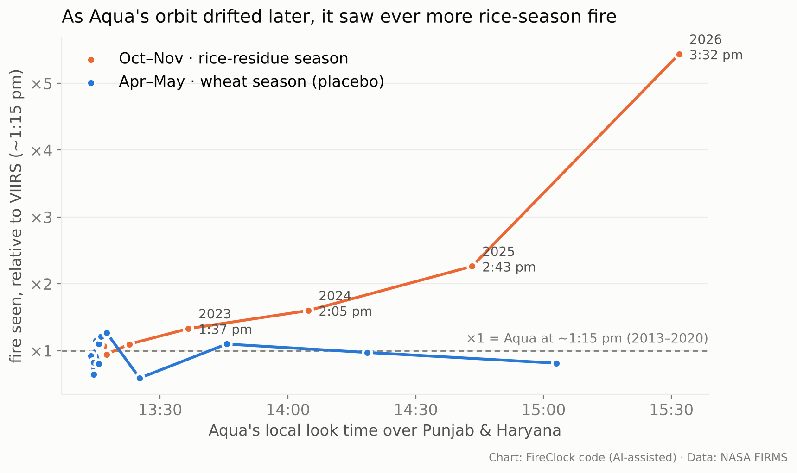
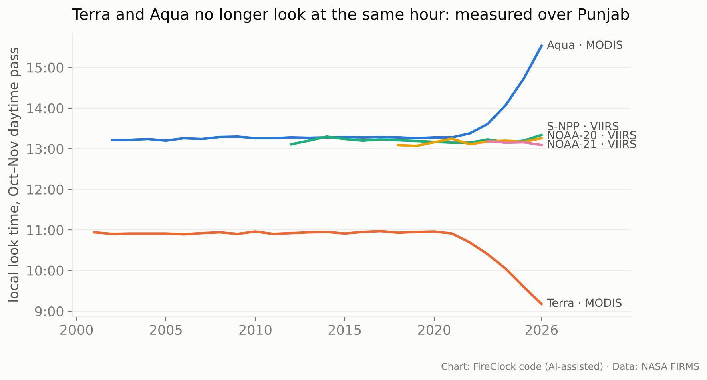
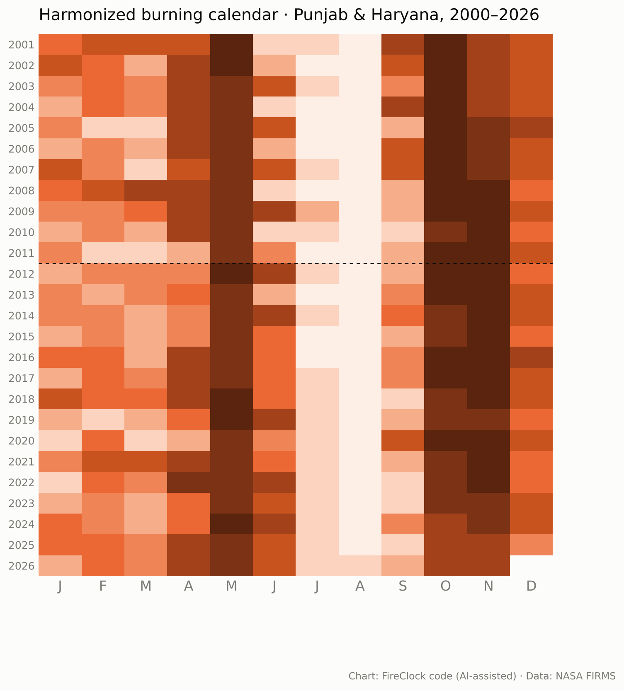
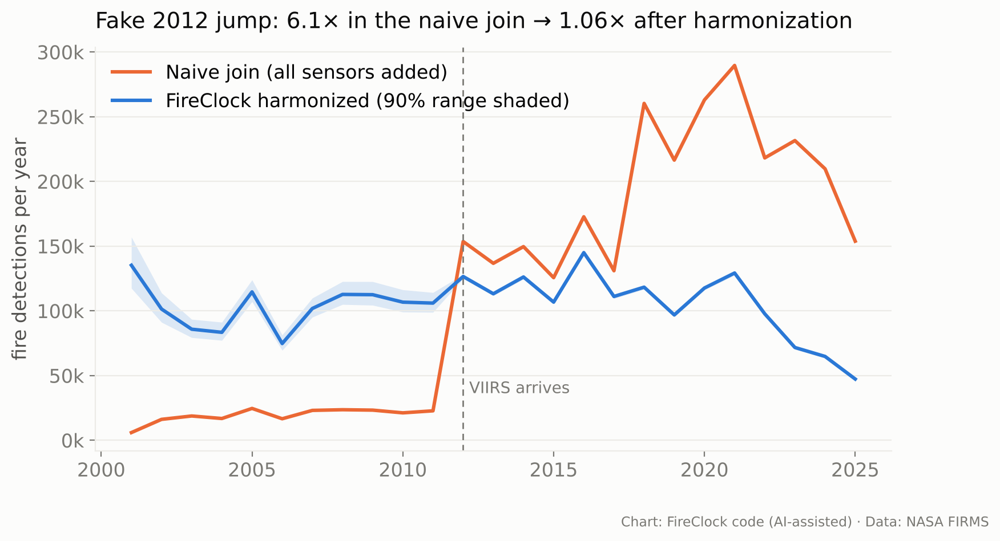
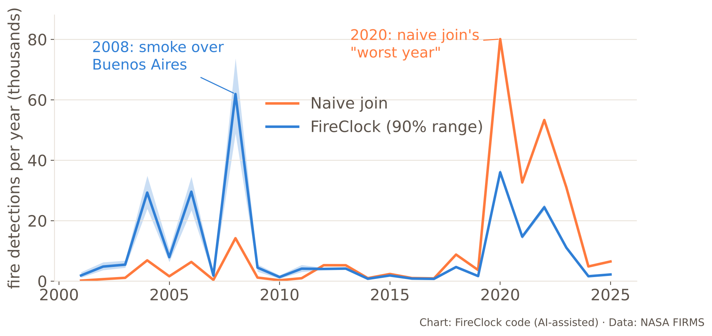

# FireClock
### A fire calendar that knows what time it is

**NASA Space Apps Challenge 2026** · Challenge: *Harmonization of MODIS and VIIRS Hot Spots* · Team FireClock

**▶ Live app: https://fireclock-team.github.io/fireclock/** · **📄 [Technical paper (PDF)](docs/FireClock_paper.pdf)** · **🖥 [Slides (PDF)](docs/FireClock_slides.pdf)**

> Every fire calendar assumes satellites look at the same hour every year. They don't, and neither do the fires.



---

## The 30-second version

- **One consistent fire record, 2000 → today.** 3,057,777 NASA FIRMS detections from five satellites (Terra, Aqua, S-NPP, NOAA-20, NOAA-21) over Punjab & Haryana, joined on one scale. The fake **6.1× jump** a naive join shows in 2012 becomes **1.06×**.
- **Tested on years it never saw.** Leave-one-year-out validation: median annual error **7.3%**, R² = 0.983 on monthly totals.
- **A new finding from NASA's own data.** Aqua's orbit has been drifting, and over Punjab its look time moved from **1:17 pm to 3:32 pm**. As it looked later, it saw **×1.3 → ×1.6 → ×2.3 → ×5.4** as much rice-season fire as the satellites that still pass at ~1:15 pm. In the wheat season (placebo), with the same satellite and the same drift, it stays **flat**.
- **Proven on a second continent.** The same code on Argentina's Paraná Delta corrects the record there too: the naive join calls 2020 the worst fire year; FireClock shows **2008** was bigger, the year the Delta's smoke covered Buenos Aires. Aqua drifted even later there (3:55 pm) but saw **no** extra fire (×1.1), so the Punjab ×5.4 is about when people burn, not the satellite.
- **Why it matters.** The satellite counts used to track crop burning in North India see a timing-sensitive slice of the season. The harmonized October 2026 count is ~91% below normal. FireClock flags that a falling count here can mean fewer fires *or* fires the satellites didn't see.
- **A tool, not just a finding.** Any area, any date range: burning calendar, current month vs history, a satellite-clock check, and a CSV download, all in the browser.

---

## Why it matters

Every October and November, smoke from crop-residue burning in Punjab and Haryana adds to some of the worst air on Earth across Delhi and the Indo-Gangetic Plain. Fire counts from NASA–NOAA satellites are the standard way this burning is tracked, and they are used to judge whether policies to stop it are working.

If those counts depend on *what time the satellite looks*, a falling trend can be misread as success. FireClock gives fire managers, air-quality planners, scientists and journalists one record they can compare across decades, and tells them when to be careful.

The method is not specific to India: it already runs unchanged on Argentina's Paraná Delta (see below), and any region where fires follow a daily cycle (agricultural burning, savanna fires) can have the same blind spot. The app works on any box inside the precomputed regions, and the scripts run anywhere FIRMS has data.

---

## The four breaks in the fire record

| # | Break | When | What it does to the record | FireClock's answer |
|---|---|---|---|---|
| 1 | **New sensor**: VIIRS 375 m joins MODIS 1 km | 2012 | Counts jump ~6× overnight | MODIS→VIIRS exchange rate, per calendar month, with 90% range |
| 2 | **Drifting orbits**: Terra (earlier), Aqua (later) out of fuel | 2020 → | The "same" MODIS sensor looks at a different hour each year | Calibrate **only on 2013–2020**; measure each satellite's look time from the data |
| 3 | **Platform ends**: S-NPP stops delivering data | 2 Nov 2026 | The usual VIIRS reference disappears | NOAA-20/21 bridged to the S-NPP scale; satellites averaged, never added |
| 4 | **Timing of burning**: fire after the ~1:15 pm pass | rice season | Counts miss late-afternoon fire | **Measured** with Aqua's drift + placebo; flagged in the app |

Most harmonization tools fix break 1. FireClock handles all four.



---

## What the challenge asks → what FireClock delivers

| Challenge objective | FireClock |
|---|---|
| Harmonize MODIS and VIIRS so the sensor of origin no longer matters | One record on a single-VIIRS scale, 2000→today, with a 90% range |
| Burning activity calendar from the early 2000s to the present | Month × year heatmap, harmonized or raw toggle |
| Select a region and a date range | Presets, typed box, or draw a box on the map (0.25° grid) |
| Compare the current month with the historical median | "Latest complete month" card: above / normal / below vs 2003–2022 |
| Accessible colour ramps | Single-hue sequential ramp, quantile steps, values in every tooltip |
| Downloadable CSV | One click: harmonized, 90% range, raw, source per month |
| Key indices and visualizations | Critical period, peak month, year-by-year record, the satellite-clock panel |



---

## Results: Punjab & Haryana

**Harmonization.** The naive join of all sensors shows a fake 6.1× jump in 2012; the harmonized record shows 1.06×.



**Validation on unseen years** (each year 2013–2020 hidden in turn, predicted from MODIS alone):

| Converted sensor → VIIRS | Median annual error | Median monthly error, busy months | R² (log monthly) |
|---|---|---|---|
| Terra + Aqua | 7.3% | 10.3% | 0.983 |
| Aqua only | 6.0% | 10.0% | 0.979 |
| Terra only (used before July 2002) | 10.7% | 17.2% | 0.967 |

**Aqua as an accidental afternoon fire-watcher.** Aqua's daytime count relative to the fixed VIIRS satellites, normalized to 2013–2020:

| Year | Aqua look time | Rice season (Oct–Nov) | Wheat season (Apr–May, placebo) |
|---|---|---|---|
| 2022 | 1:23 pm | ×1.10 | ×1.27 |
| 2023 | 1:37 pm | ×1.33 | ×0.59 |
| 2024 | 2:05 pm | ×1.60 | ×1.10 |
| 2025 | 2:43 pm | ×2.26 | ×0.97 |
| 2026 (to 13 Nov) | 3:32 pm | ×5.44 | ×0.81 |

**Same-day test (supporting).** On days when two identical VIIRS instruments pass the same fields up to ~1 h apart, the later look sees **+28.6%** (2018–21) and **+29.6%** (2022–now) more rice-season fire per hour of delay (90% CIs 21–36% and 25–34%), with viewing angle controlled. Wheat season, 2022–now: +8.4%. The satellites pass on the rising side of the daily fire cycle.

---

## Results: Paraná Delta, Argentina (same code, another continent)



The identical pipeline, run on 280,737 detections over Argentina's Paraná Delta wetlands (a different hemisphere, ecosystem and burning practice):

| | Naive join | FireClock |
|---|---|---|
| Biggest fire year | **2020** (80,075 detections) | **2008** (61,902; 90% range 48,848–73,718): the fires whose smoke covered Buenos Aires in April 2008 |
| 2012 sensor jump (2013–15 vs 2009–11) | 3.6× | **0.68×**, close to MODIS alone (0.75×) |
| Aqua vs VIIRS, Oct–Nov 2026 | | **×1.1**, even though Aqua now looks at **3:55 pm** |
| Hidden-year validation (MODIS→VIIRS) | | 12.3% median annual error, R² 0.86 (fewer, burstier fires than Punjab) |

**Why this matters for the finding:** Aqua drifted later over Argentina too, yet saw no extra afternoon fire. The ×5.4 over Punjab is therefore about *when people there burn*, not an artifact of the satellite.

---

## How we know it's right

| Check | What it rules out | Result |
|---|---|---|
| Leave-one-year-out validation | Overfitting the exchange rate | 7.3% median annual error |
| Calibrate on 2013–2020 only | Contamination from orbit drift | Aqua/VIIRS rate shifts after 2022 exactly when Aqua starts drifting |
| Wheat-season placebo | Sensor ageing, orbit-height or pixel-size artifacts | Flat (×0.6–1.3) while rice season rises to ×5.4 |
| Dose-response | A one-off coincidence | Effect grows every year as the look time moves later |
| Pixel-size (viewing angle) control | Off-nadir pixels detecting fewer fires | Elasticity ≈ −1, as physics predicts; effect remains |
| VIIRS satellites averaged, not added | "More satellites = more fire" | Single-satellite scale throughout |
| Static sources removed | Factories and flares counted as fire | 37,781 detections removed (NASA `type` label) |
| Independent study | Our method alone | Agrees with a 2026 geostationary study of the same region |
| Second region (Paraná Delta, Argentina) | A satellite artifact that would appear everywhere | Aqua drifted to 3:55 pm there too, but stays flat (×1.1) |

**What our data does not show:** the one-hour same-day effect is similar before and after 2022, so FireClock does not claim to date a shift in burning time. That evidence comes from the geostationary study cited below.

---

## What's new

- **Treating the satellite clock as a variable, not a constant.** Fire calendars normally assume each sensor's look time is fixed; FireClock measures it per area, per season, per year from the detections themselves.
- **Turning a problem into an instrument.** Aqua's orbit drift is usually a nuisance for harmonization. FireClock uses it as a slow scan across the afternoon, revealing fire the fixed satellites can't see.
- **Pre-drift calibration.** The MODIS→VIIRS exchange rate is learned only from years when both MODIS orbits were controlled, so the post-2022 drift doesn't leak into the harmonized record.
- **A warning, not just a number.** Users see *when* a count can't be trusted at face value.

---

## Method

1. **Data.** All FIRMS active-fire detections in the area: MODIS Collection 6.1 (Terra 2000→, Aqua 2002→) and VIIRS 375 m (S-NPP 2012→2 Nov 2026, NOAA-20 2018→, NOAA-21 2023→). Standard-processing archive where available, near-real-time after it; overlaps de-duplicated. Detections NASA labels as volcano, offshore or other static source are removed. 26 years, 3,057,777 detections, about 3,900 API requests, all scripted.
2. **Local solar time.** Each detection's UTC acquisition time is converted to local solar time (UTC + longitude/15), so look times are comparable across years and places.
3. **One VIIRS scale.** NOAA-20 and NOAA-21 are bridged to S-NPP with monthly overlap ratios, then averaged across the satellites flying that month.
4. **MODIS → VIIRS exchange rate.** For each calendar month *m*: k<sub>m</sub> = (V<sub>m</sub> + τ·k̄) / (M<sub>m</sub> + τ), learned on 2013–2020 only, with shrinkage τ chosen by leave-one-year-out error. Terra-only months (before July 2002) use a Terra-specific rate. Uncertainty: 500× year-block bootstrap of k, plus Poisson noise on counts, giving a 90% range.
5. **Calendar.** Monthly harmonized totals on a 0.25° grid; any box is summed in the browser. "Normal" = 25th–75th percentile of 2003–2022.
6. **Satellite clock.** Count-weighted mean local look time per satellite, per season, per year. *Aqua probe:* Aqua's seasonal count ÷ mean single-VIIRS count, normalized to 2013–2020, for rice vs wheat season. *Same-day test:* for VIIRS pairs over the same area on the same day, log(n<sub>b</sub>/n<sub>a</sub>) is regressed on the look-time difference and log pixel-area ratio, with pair fixed effects; 90% CIs by bootstrap over days.

Code: `scripts/fetch_firms.py` (download + aggregation), `scripts/harmonize.py` (harmonization, validation, clock analysis), `scripts/make_figures.py` (figures), `docs/index.html` (the app: plain HTML/JS, no build step, Leaflet map).

---

## Run it yourself

```
pip install requests pandas numpy matplotlib
python scripts/fetch_firms.py YOUR_FIRMS_MAP_KEY nw_india    # free key: firms.modaps.eosdis.nasa.gov/api/map_key/
python scripts/harmonize.py nw_india
python scripts/make_figures.py out/nw_india docs/img
# copy out/nw_india/{cells,summary,calendar,clock_pairs}.json to docs/data/nw_india/ and serve docs/ with any static server
```

New region: add a bounding box to `REGIONS` in `fetch_firms.py` and to the region list in `docs/index.html`.

---

## Limits

A hotspot is a satellite detection, not a fire, a burned area or an emissions estimate. Clouds and thick smoke hide fires; small fields can start and finish burning between passes. The Aqua probe measures *relative* fire at different look times; it does not give a total count of missed fires. The 2026 season is partial (to 13 November).

---

## Data and references

- NASA FIRMS active fire data: MODIS Collection 6.1 (doi:10.5067/FIRMS/MODIS/MCD14ML), VIIRS 375 m S-NPP, NOAA-20, NOAA-21 (doi:10.5067/FIRMS/VIIRS/VNP14IMGT_NRT.002 and companion products). https://firms.modaps.eosdis.nasa.gov/
- NSIDC, MODIS: ongoing changes in Terra and Aqua orbits. https://nsidc.org/data/modis
- NASA FIRMS / Earthdata: Suomi NPP data delivery ends November 2026.
- "Timing the Flames: Geostationary Satellite Detection of Diurnally Shifting Stubble Burning in Northwestern India", *Remote Sensing* 18(10):1506, 2026. https://doi.org/10.3390/rs18101506
- Berbery, Ciappesoni & Kalnay (2008), "The smoke episode in Buenos Aires, 15–20 April 2008", *Geophysical Research Letters* 35, L21801. doi:10.1029/2008GL035278
- ThePrint (2025): ISRO study suggests farm fires shifted to late afternoon.
- Software: Leaflet (BSD-2), OpenStreetMap tiles (ODbL), pandas, NumPy, Matplotlib, Requests.

---

## Use of AI

FireClock was built with AI-assisted development (Claude, Anthropic) for coding and drafting. The author chose the scientific question and approach, ran the NASA data pipeline, made the analysis decisions, and checked every result. All figures are computed directly from NASA FIRMS data by the open-source code in this repository, and no AI-generated images, audio or video are used. Files developed with AI assistance note this in their header.

## Licence

MIT. See [LICENSE](LICENSE).
